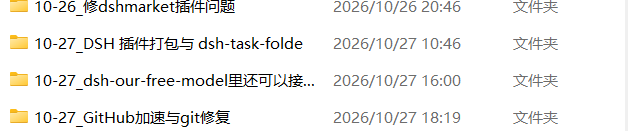

# dsh-task-folder

让每个会话 / 任务的产物自动收进**自己的文件夹**，续做同一任务时换会话也能落回同一个文件夹，工作区根目录不再散落一堆文件。



## 文档

| 文档 | 内容 |
| --- | --- |
| [01 · 它解决什么问题](docs/01-它解决什么问题.md) | 痛点、核心能力与边界 |
| [02 · 任务目录规则](docs/02-任务目录规则.md) | 命名、`~2` 冲突后缀、`.dsh-task-folder` 标记、空目录回收 |
| [03 · task_folder 工具用法](docs/03-task_folder%20工具用法.md) | 五个 action 的用法与失败行为 |
| [04 · 配置项详解](docs/04-配置项详解.md) | 全部配置项及判定细节 |
| [05 · 旧会话与升级行为](docs/05-旧会话与升级行为.md) | **升级/安装前已存在的会话会不会被收编**（`adoptOldSessions`） |
| [06 · 已知限制与排错](docs/06-已知限制与排错.md) | 限制清单与常见问题 |

> 从旧版本升级或怀疑「插件没生效」时，**先看第 05 篇**。

## 安装

本插件是纯 JavaScript、**没有任何构建步骤**，装完即可用。多数 DSH 插件用 TypeScript 编写、需要 `prepare` 构建，而 pnpm ≥10 默认拒绝执行 git 依赖的构建脚本，用户得额外在 `pnpm-workspace.yaml` 里加 `allowBuilds` 放行才能装上；本插件不存在这个问题。

**方式一：插件市场（dshmarket）**

在市场的安装框里填仓库地址：

```
Luoyue-HF/dsh-task-folder
```

**方式二：dsh CLI**

```sh
dsh plugin --profile desktop add github:Luoyue-HF/dsh-task-folder
```

**方式三：本地目录或 tarball**

```sh
dsh plugin --profile desktop add ./dsh-task-folder
dsh plugin --profile desktop add ./dsh-task-folder-0.2.1.tgz
```

装完**重启 DSH** 生效（新加入的 bundle 需要重启才会被加载）。

> 若没有 `dsh` CLI（桌面版通常不自带），也可以进 profile 目录手动接线：`cd "$DSH_HOME/profiles/desktop" && pnpm add github:Luoyue-HF/dsh-task-folder`，再把 `"dsh-task-folder"` 加进该目录 `package.json` 里 `dsh.profile.bundles` 数组的末尾。

## 兼容性

| 项目 | 要求 |
| --- | --- |
| DSH | `>= 0.2.1-rc.2` |
| Node.js | `^22.19.0` 或 `>= 24.0.0` |

## 它做什么

1. **新会话自动分目录**：根会话第一次真正跑任务时，就在工作区根下建好 `<月日>_<任务名>/`，并把该会话的工作目录切过去。之后会话里生成的所有文件默认写在这里。只是打开会话、改标题不会产生空文件夹。
2. **换会话续同一任务**：新会话里说一句「继续做 季度汇报PPT」，或直接调 `task_folder` 工具 `action=reuse`，就切回那个已有目录。
3. **目录名跟着任务走**：先按首条消息给个名字，会话标题生成后自动改成更准确的标题名；手动 rename 过就不再自动改。
4. **续用同一会话 / 分支**：resume、fork、clear、compact 都继承原来的目录，不会新建。
5. **升级后自动收编老会话**：插件装上/升级前就已经开着、还在用的长会话，默认也会被收编进任务目录（配置项 `adoptOldSessions`，默认 `true`）。早先的版本会把这类会话当作「旧会话」永久跳过，结果是插件明明装好了，正在用的那个会话产物却一直散在工作区根下——这也是最常见的「插件没生效」误判。改成 `false` 就恢复「老会话一律不动」。

## 目录长什么样

一个任务一个文件夹，直接放在工作区下：

```
DSH工作区/
├── 10-26_季度汇报PPT/
│   ├── 汇报.pptx
│   ├── 数据.xlsx
│   └── .dsh-task-folder        ← 本插件留下的标记文件（隐藏）
├── 10-26_竞品调研/
├── 10-27_网站改版/
└── 论文与文献/                  ← 你自己建的目录，插件不碰
```

- 名字是 `<月日>_<任务名>`，日期取**本地日期**，不带年份。
- 同一天重名时追加 `~2`、`~3`，不挤占别的任务。用 `~` 而不是 `_` 是为了不和你名字里本来就有的 `_数字`（如 `方案_2`）混淆。
- 任务名限制 24 字符，自动清掉 `\ / : * ? " < > |` 与控制字符，中文和 emoji 保留；截断按字符（码点）算，不会切出半个 emoji。
- 旧格式 `2026-10-26_07_任务名` 的目录仍被识别为本插件的任务目录（不会被当成新会话重复分配）。

### 怎么认出「这是本插件建的目录」

因为任务目录散在工作区根下，光看名字分不清谁建的。本插件建目录时会写一个隐藏标记文件 `.dsh-task-folder`，扫描时只认带标记的目录（以及旧格式带序号的老目录）。你手建的同名格式目录不会被误认、不会被当成「已存在的任务」抢走，也不会出现在 `list` 里。

## 工具

模型可主动调用 `task_folder`：

| action | 作用 |
| --- | --- |
| `show` | 看当前任务目录、任务目录根、任务名/月日 |
| `list` | 列出全部任务目录（最多 40 个，`*` 标记当前） |
| `rename` | 改任务名（`name` 参数），目录当场重命名 |
| `reuse` | 切到已有任务目录（`name` 支持完整目录名、任务名、部分匹配） |
| `new` | 另开一个新目录（可带初始名） |

## 配置

```yaml
- id: dsh-task-folder
  config:
    enabled: true       # 总开关
    rootMode: workspace # workspace=任务目录根在当前工作区内；custom=用 rootPath
    subdir: ''          # 留空（默认）= 任务目录直接放工作区根下；填「产物」则集中到 <工作区>/产物/
    rootPath: ''        # rootMode=custom 时用；留空回退 ~/Documents/DSH-产物
    autoTitle: true     # 标题可用后自动改成标题名
    maxNameChars: 24    # 任务名最大字符数
    autoReuse: true     # 首条消息唯一提到某已有任务名时自动切过去
    adoptOldSessions: true # 插件升级前就开着的会话也收编进任务目录；false=老会话不动
```

`autoReuse` 只在会话第一次真正跑任务时判断一次，且要求「唯一命中 + 任务名至少 3 字符」；名字太泛（如「报告」）命中多个就放弃，退回新建目录。想完全手动就在配置里关掉它，用 `task_folder action=reuse`。

`subdir` 填了值（比如 `产物`）时有两点不同：任务目录都收在该子目录下，且不再需要标记文件来区分（整个子目录就是插件独占的）。

## 设计取舍

- **任务目录根放在工作区内**：完全避开文件沙箱与权限边界，产物天然属于这个工作区，侧边栏、文件树、会话继承都能看到。
- **用标记文件而不是集中目录**：既能一个任务一个文件夹平铺在工作区，又不会把用户自己的目录误判成任务目录。
- **目录写在会话自己的 cwd header 里**：不额外维护状态文件。插件重装、进程重启、会话恢复都不丢——resume 时读 header 就知道该在哪。
- **只服务根会话，子代理跟随主会话**：子代理与派生会话（`origin === 'subagent'` / `parentSession` / `delegationDepth > 0`）不另开目录，而是**直接切到父会话的任务目录**，产物与主会话放在一起。0.2.1 及以前只做「不另开目录」，子代理仍停在工作区根，于是一个任务会炸出十几个空文件夹。
- **切目录失败只告警**：`workingDirectory.set` 抛错（比如目录被别人删了）不会让会话创建失败，回退到原工作区继续跑。
- **重命名失败不抛错**：文件被占用时改不了名就保持原名并记一条告警，绝不因为改不了名而中断任务。

## 已知限制

- 只有通过本插件创建目录的会话才有自动目录；已经结束的历史会话不会追溯归档。
- 目录名一旦被别的程序占用（文件锁），改名会跳过并告警，需要手动 `task_folder action=rename` 重试。
- 任务目录本身不会自动清理（空目录会回收，有内容的不会），长期使用请自行归档。

## 开发

```sh
git clone https://github.com/Luoyue-HF/dsh-task-folder.git
cd dsh-task-folder
node --test folders.test.js    # 19 项用例
```

## 许可证

[MIT](LICENSE)
